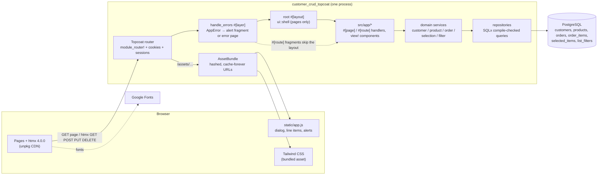
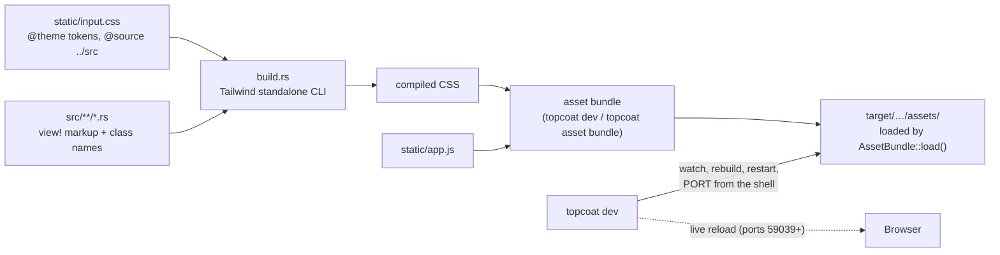
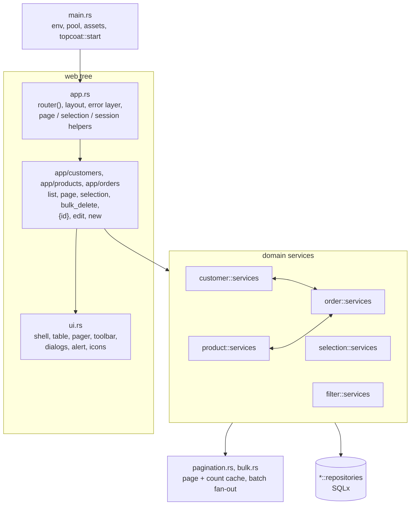

# Architecture

One Rust binary serves server-rendered HTML; htmx in the browser swaps fragments; PostgreSQL holds
all state. There is no JSON API, no SPA and no separate frontend build.

This page is the big picture only. Details live in one place each:

| For | See |
|---|---|
| Rules and conventions (layering, naming, errors, testing) | [`CLAUDE.md`](../CLAUDE.md) |
| Every endpoint and what it does, step by step | [`interaction-diagrams/`](interaction-diagrams/README.md) |
| Tables, keys, delete and money rules | [`er-diagram.md`](er-diagram.md) |

## Runtime

- **Pages vs fragments.** Only the three list screens are `#[page]`s (full documents, wrapped by
  the root layout). Every htmx endpoint is a `#[route]` returning a bare fragment, often with extra
  out-of-band pieces.
- **Errors** all leave through the one `handle_errors` layer; handlers just use `?`
  ([details](interaction-diagrams/13-errors.md)).
- **State** is all in Postgres, including each browser's list selection
  ([`selected_items`](er-diagram.md#selection-storage)) and search criteria
  ([`list_filters`](er-diagram.md#filter-storage)). The process keeps only the pool and a
  30-second cache of list counts, which is safe to lose.
- **Every list interaction has the same shape:** the browser sends only what the user did plus the
  current `page`/`query_id` (hidden inputs, via `hx-include`); the server re-reads its own state
  (selection and search filter) and answers with the fragments to swap. Search criteria are sent
  once, to `/search`, and never again.

### Build and dev tooling

No Node.js, nothing generated is committed. `.sqlx/` (query metadata) is committed so the crate
builds with `SQLX_OFFLINE=true`.

## Module dependencies

- **Web tree** is the only place Topcoat types appear; module paths are URLs. **Domain** has the
  rules (`services.rs`) and the SQL (`repositories.rs`), and returns `error::AppError` throughout
  (not drawn: every box uses it). The full layering rules are in `CLAUDE.md`.
- **Customer/product ↔ order is a two-way service dependency**, through services only (never each
  other's repositories): customers and products ask orders "is anything still using this?" before
  deleting, and orders ask customers/products "does this exist, what's its price?" when saving.
- `pagination`, `bulk`, `selection`, `filter` are the shared pieces behind the list screens
  (paging, bulk delete, multi-select, stored search criteria). The resource services take a
  `filter::ListFilter` and turn it into their own `WHERE` clause. `ui.rs` also reads `pagination::Page`, only to render the pager.
