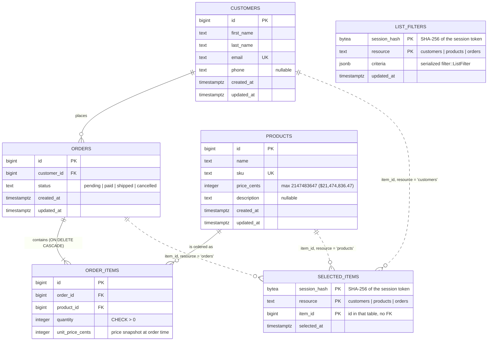

# ER diagram

Source of truth: [`migrations/`](../migrations/). This page describes the schema as of
`20261016000000_create_list_filters.sql`; update it in the same change as any new migration.
To check it against a live database: `psql "$DATABASE_URL" -c '\d <table>'`.

Solid lines are real foreign keys. Dashed lines are references the database doesn't enforce
(`selected_items` points at whichever table its `resource` column names). `list_filters` refers to
no row at all: it holds one browser session's search criteria for one list.

## Tables

| Table | What a row is | Keys and constraints | Indexes |
|---|---|---|---|
| `customers` | A customer profile | `id` BIGSERIAL PK; `customers_email_key` UNIQUE (`email`) | `idx_customers_last_name` (`last_name`) |
| `products` | A catalog item | `id` BIGSERIAL PK; `products_sku_key` UNIQUE (`sku`) | `idx_products_name` (`name`) |
| `orders` | One order by one customer | `id` BIGSERIAL PK; `customer_id` → `customers.id`; `orders_status_check` | `idx_orders_customer_id` |
| `order_items` | One line of an order | `id` BIGSERIAL PK; `order_id` → `orders.id` **ON DELETE CASCADE**; `product_id` → `products.id`; `quantity > 0` | `idx_order_items_order_id` |
| `selected_items` | One ticked row on a list screen, for one browser session | PK (`session_hash`, `resource`, `item_id`); `resource` CHECK | `idx_selected_items_selected_at` |
| `list_filters` | One browser session's search criteria on one list screen | PK (`session_hash`, `resource`); `resource` CHECK | `idx_list_filters_updated_at` |

`created_at` / `updated_at` default to `now()`. Every `id` is a `BIGSERIAL`.

## Relationships and delete rules

- **Customer → orders (1 : 0..n).** `orders.customer_id` is a plain FK (no cascade), so Postgres
  refuses to delete a customer who has orders. `customer::services::delete` checks first and
  returns a readable message ("Cannot delete this customer: 1 order still references them.")
  instead of the FK error. Bulk delete reports the same message per customer.
- **Order → items (1 : 1..n).** Deleting an order deletes its items (`ON DELETE CASCADE`).
  "At least one item" is enforced by `order::services`, not the database. An order edit replaces
  the full item set (delete, then re-insert) in one transaction.
- **Product → order items (1 : 0..n).** Plain FK, so a product used in any order can't be deleted;
  `product::services::delete` checks first ("Cannot delete this product: it is used in N
  orders.").
- **`selected_items` → any list table (soft).** No FK by design: a selected row may be deleted
  elsewhere at any time. Deleting a row through the app also removes it from every session's
  selection (`selection::services::forget_item`), and bulk routes drop ids that no longer exist.

## Money

- Amounts are integer **cents**. `products.price_cents` and `order_items.unit_price_cents` are
  `INTEGER`, so a single price is at most $21,474,836.47; `product::services` rejects anything
  larger rather than letting the cast saturate.
- `order_items.unit_price_cents` is a **snapshot** of the product's price when the order was
  saved, so later price changes don't rewrite old orders. The server sets it; the form never sends
  prices.
- An order's total isn't stored. It's `SUM(quantity::bigint * unit_price_cents)` in
  `order/repositories.rs`, read as `i64`. Keep the `::bigint` before the multiply: `INTEGER *
  INTEGER` overflows above about $21.4M per line (this broke the Orders page once).

## Selection storage

- `selected_items.session_hash` is the SHA-256 token hash from `topcoat::session` (32 bytes), so
  the raw session token is never stored. Rows with no session simply don't exist.
- A fresh visit to a list page clears that session's rows for the resource; Prev/Next don't.
- Rows older than one day are purged on the next selection write (`selection::services`,
  `MAX_SELECTION_AGE`); `idx_selected_items_selected_at` serves that delete.

## Filter storage

- `list_filters.criteria` is a JSON `filter::ListFilter` (today `{"search": "ada"}`). New criteria
  are new fields with serde defaults, so old rows still load; a row that doesn't deserialize is
  treated as no filter (logged), never an error.
- Only `POST /<resource>/search` writes it; an empty search deletes the row, so "no filter" is
  always "no row". Every other list request reads it.
- A fresh list visit keeps the filter (the box comes back pre-filled) but clears that list's
  `selected_items`. Creating a record clears the filter.
- Rows not updated for a day are purged on the next write (`filter::services`, `MAX_FILTER_AGE`).

## List ordering (for stable paging)

`OFFSET` paging needs a total order, so every list query ends with `id`:

| List | `ORDER BY` | Index used |
|---|---|---|
| Customers | `last_name, first_name, id` | `idx_customers_last_name` |
| Products | `name, id` | `idx_products_name` |
| Orders | `created_at DESC, id DESC` | none (fine at this size) |
