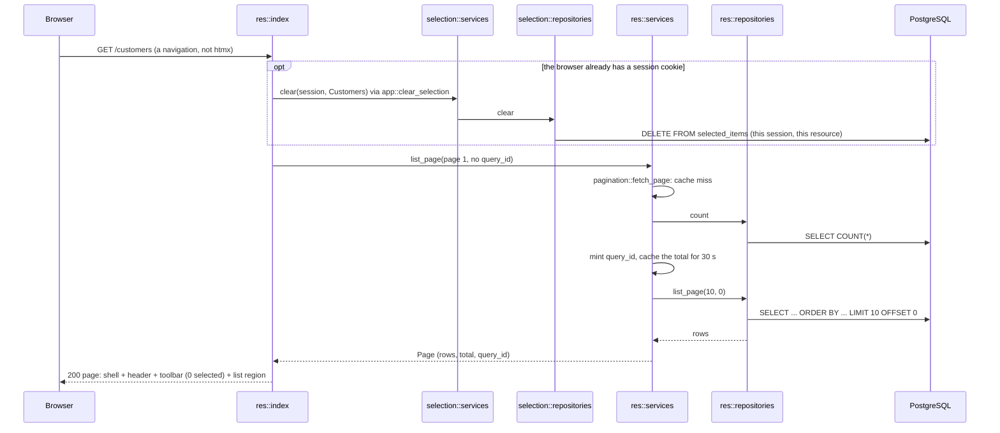

# `GET /<res>`: the list page

A fresh visit always starts with nothing selected. Viewing a page never starts a session.

---
[All endpoints](README.md) · [Per-resource differences](README.md#per-resource-differences) · [Errors](13-errors.md)
