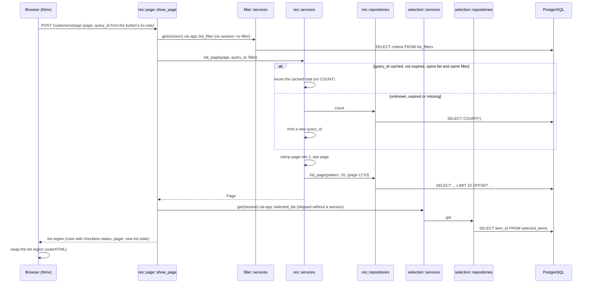

# `POST /<res>/page`: Prev / Next

Paging never changes the selection; ticked rows on other pages stay ticked. Any criteria in the
posted form are ignored: the filter comes only from the server.

---
[All endpoints](README.md) · [Per-resource differences](README.md#per-resource-differences) · [Errors](13-errors.md)
