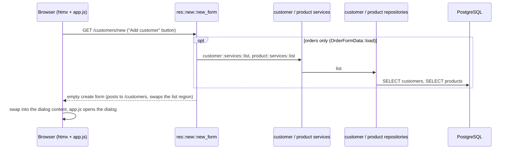

# `GET /<res>/new`: open the create form

Submitting it is [05-post-create.md](05-post-create.md).

---
[All endpoints](README.md) · [Per-resource differences](README.md#per-resource-differences) · [Errors](13-errors.md)
