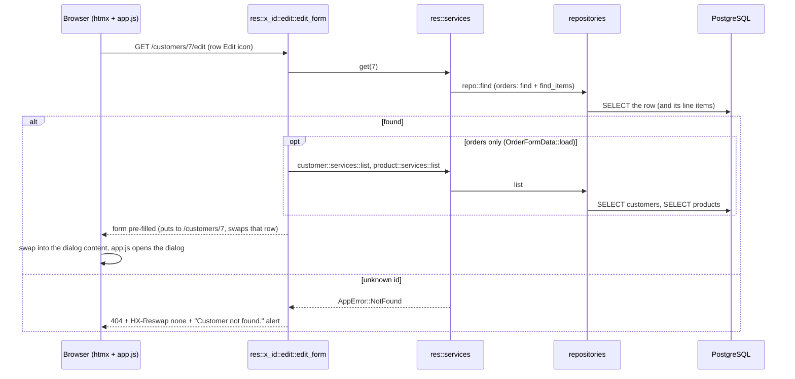

# `GET /<res>/{id}/edit`: open the edit form

Submitting it is [07-put-update.md](07-put-update.md).

---
[All endpoints](README.md) · [Per-resource differences](README.md#per-resource-differences) · [Errors](13-errors.md)
