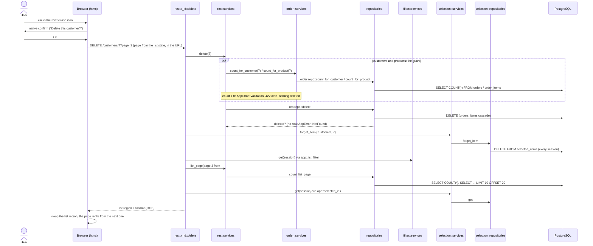

# `DELETE /<res>/{id}`: delete one row

htmx v4 sends a `DELETE`'s parameters in the query string, so the handler reads `page` with
`#[query_params]`.

---
[All endpoints](README.md) · [Per-resource differences](README.md#per-resource-differences) · [Errors](13-errors.md)
