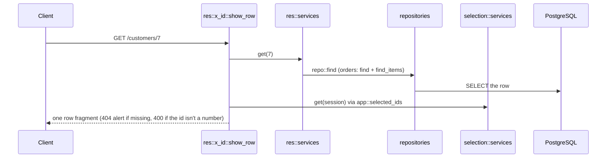

# `GET /<res>/{id}`: one row

Nothing in the UI calls this today; the integration tests use it to check 404 and 400 handling. It
is the natural target for a "cancel edit, re-render the row" action if one is ever added.

---
[All endpoints](README.md) · [Per-resource differences](README.md#per-resource-differences) · [Errors](13-errors.md)
