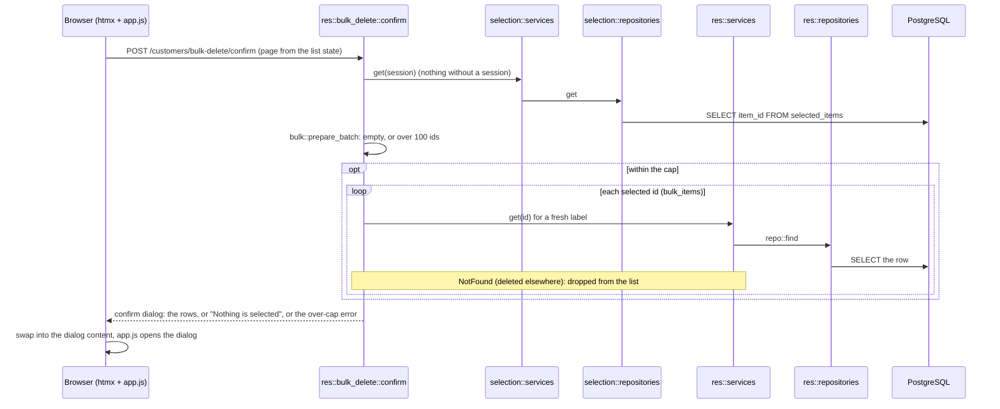

# `POST /<res>/bulk-delete/confirm`: the confirm dialog

The dialog's form carries only `page`; it never sends ids.

---
[All endpoints](README.md) · [Per-resource differences](README.md#per-resource-differences) · [Errors](13-errors.md)
