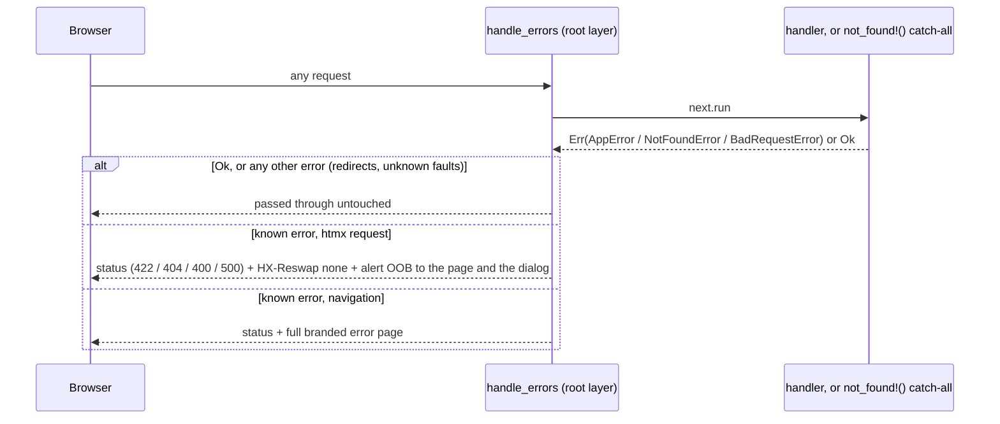

# Errors and unknown URLs

| Error | Status | From |
|---|---|---|
| `AppError::Validation` | 422 | services: bad input, duplicates, delete guards, bad selection, bulk cap |
| `AppError::NotFound` | 404 | services: unknown id |
| `NotFoundError` | 404 | `not_found!()`: no route matched the URL |
| `BadRequestError` | 400 | `module_param!`: `{id}` isn't a number ("Invalid customer id.") |
| `AppError::Database` | 500 | anything else from Postgres; logged, shown as "Something went wrong" |

---
[All endpoints](README.md) · [Per-resource differences](README.md#per-resource-differences) · [Errors](13-errors.md)
