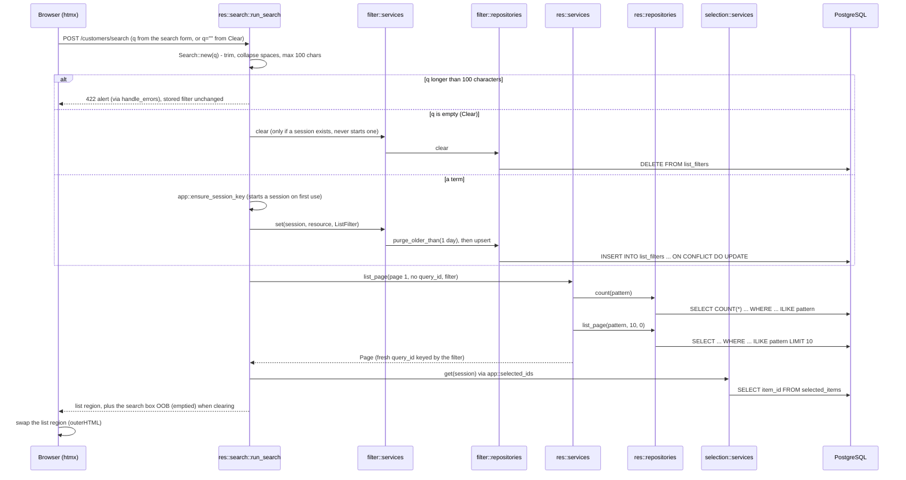

# `POST /<res>/search`: run or clear a search

The only request that carries search criteria. It stores them as this browser's filter for the
list, and every other list request ([2](02-get-list-page.md), [3](03-post-page.md),
[8](08-delete-row.md), [10](10-post-selection.md)–[12](12-post-bulk-delete.md)) reads them back
from the server.

- **Ticks are kept**: a search never touches `selected_items`, so rows ticked under another
  search stay ticked and still count in the toolbar.
- The pattern is `%term%` with `\`, `%` and `_` escaped, so they match literally. What each list
  matches is in [Per-resource differences](README.md#per-resource-differences).
- The count cache key includes the filter, so a `query_id` minted before the search is a miss.
- A normal search doesn't re-render the box, so the input keeps its text and focus.

---
[All endpoints](README.md) · [Per-resource differences](README.md#per-resource-differences) · [Errors](13-errors.md)
